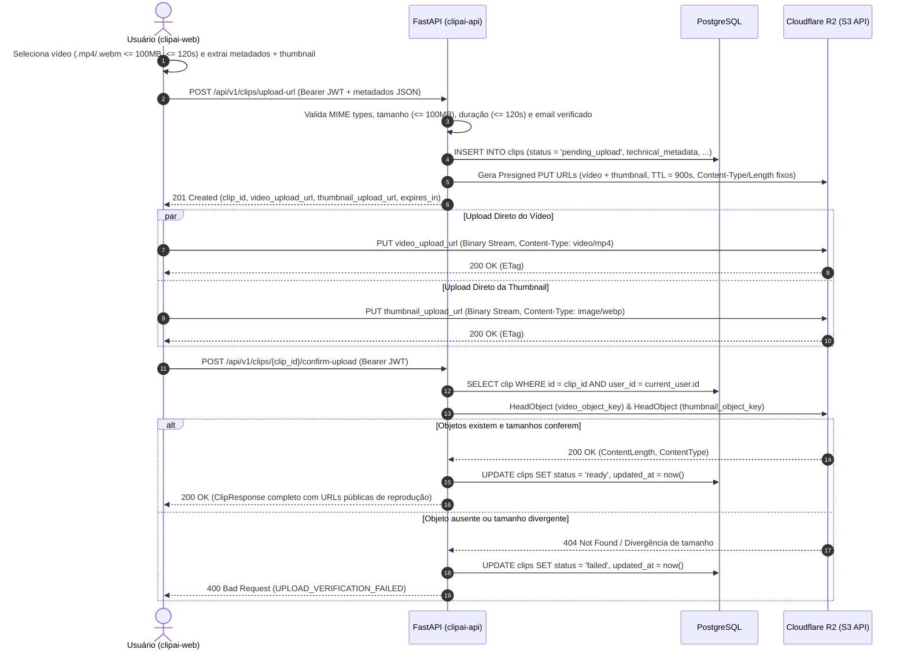

# REST API Contract (`/api/v1`) — CLIPAÍ

## 1. Convenções Gerais

- **Base URL:** `/api/v1`
- **Formato de Payload:** `application/json; charset=utf-8`
- **Nomenclatura JSON:** `snake_case` em todos os campos de request e response.
- **Timestamps:** ISO 8601 em UTC (ex.: `2026-11-21T22:15:00Z`).
- **Idioma:** Chaves JSON e códigos internos (`error.code`) em inglês; mensagens voltadas ao usuário final (`error.message`, `detail`) em **português do Brasil (PT-BR)**.

### 1.1. Headers Padrão
| Header | Obrigatório? | Descrição |
| :--- | :---: | :--- |
| `Content-Type: application/json` | Sim (em `POST`/`PATCH`) | Tipo de mídia das requisições à API. |
| `Authorization: Bearer <access_token>` | Rotas autenticadas | Token JWT de acesso (TTL: 15 minutos). |
| `Cookie: clipai_refresh_token=<token>` | `/auth/refresh` e `/auth/logout` | Cookie `HttpOnly; Secure; SameSite=Lax; Path=/api/v1/auth`. |

### 1.2. Envelope Padronizado de Paginação
Todas as rotas de listagem aceitam os query params `page` (default: `1`, mín: `1`) e `page_size` (default: `20`, mín: `1`, máx: `50`) e retornam:

```json
{
  "items": [],
  "page": 1,
  "page_size": 20,
  "total": 142,
  "total_pages": 8
}
```

### 1.3. Formato Padronizado de Erro
Qualquer resposta com status `4xx` ou `5xx` segue estritamente este contrato:

```json
{
  "error": {
    "code": "VALIDATION_ERROR",
    "message": "Os dados enviados são inválidos. Verifique os campos e tente novamente.",
    "details": [
      {
        "field": "video_size_bytes",
        "message": "O arquivo de vídeo não pode ultrapassar 100 MB."
      }
    ],
    "request_id": "req_01JDF8K2M4N6P8Q0R2S4T6V8X0"
  }
}
```

#### Catálogo de Códigos de Erro (`error.code`)
| HTTP Status | `error.code` | Mensagem Padrão (PT-BR) |
| :---: | :--- | :--- |
| `400` | `BAD_REQUEST` | `"Não foi possível processar a requisição."` |
| `400` | `UPLOAD_VERIFICATION_FAILED` | `"Não foi possível confirmar o envio do arquivo no servidor de mídia."` |
| `400` | `INVALID_2FA_CODE` | `"Código de verificação 2FA ou código de backup inválido."` |
| `400` | `DISCORD_OAUTH_FAILED` | `"Código de autorização do Discord inválido ou expirado."` |
| `400` | `PASSWORD_REQUIRED_BEFORE_UNLINK` | `"Você não possui uma senha cadastrada. Defina uma senha antes de desvincular o Discord para não perder o acesso à sua conta."` |
| `401` | `INVALID_CREDENTIALS` | `"E-mail ou senha incorretos."` |
| `401` | `TOKEN_EXPIRED` | `"Sua sessão expirou. Faça login novamente."` |
| `401` | `INVALID_TOKEN` | `"Token de autenticação inválido ou revogado."` |
| `403` | `EMAIL_NOT_VERIFIED` | `"Confirme seu endereço de e-mail antes de realizar esta ação."` |
| `403` | `FORBIDDEN` | `"Você não tem permissão para acessar ou alterar este recurso."` |
| `404` | `RESOURCE_NOT_FOUND` | `"O recurso solicitado não foi encontrado."` |
| `409` | `CONFLICT` | `"Já existe um registro com os dados informados."` |
| `413` | `FILE_TOO_LARGE` | `"O tamanho do arquivo excede o limite máximo permitido."` |
| `415` | `UNSUPPORTED_MEDIA_TYPE` | `"Formato de arquivo não suportado. Use apenas MP4 ou WebM."` |
| `422` | `VALIDATION_ERROR` | `"Os dados enviados são inválidos. Verifique os campos e tente novamente."` |
| `429` | `RATE_LIMIT_EXCEEDED` | `"Muitas tentativas em sequência. Aguarde alguns instantes e tente novamente."` |
| `500` | `INTERNAL_SERVER_ERROR` | `"Ocorreu um erro interno inesperado. Tente novamente mais tarde."` |

---

## 2. Fluxo Sequencial de Upload via Presigned URL (Cloudflare R2)

Os arquivos de vídeo e thumbnail **nunca trafegam pelo servidor FastAPI**. O fluxo obrigatório em 3 fases está ilustrado abaixo:



---

## 3. Endpoints — Healthcheck

### `GET /api/v1/health`
Verifica a disponibilidade da API e a conectividade com o PostgreSQL.
- **Auth:** Público
- **Response `200 OK`:**
```json
{
  "status": "ok",
  "version": "1.0.0",
  "database": "connected"
}
```

---

## 4. Endpoints — Autenticação (`/api/v1/auth`)

### 4.1. `POST /api/v1/auth/register`
Registra um novo usuário e dispara o e-mail de confirmação via Resend.
- **Auth:** Público (Rate limit: 5 req/min por IP)
- **Request Body:**
```json
{
  "username": "fallen_br",
  "email": "gabriel@exemplo.com.br",
  "password": "StrongPassword!2026",
  "display_name": "Gabriel Toledo"
}
```
- **Response `201 Created`:**
```json
{
  "message": "Cadastro realizado com sucesso. Verifique sua caixa de entrada para confirmar seu e-mail.",
  "user": {
    "id": "550e8400-e29b-41d4-a716-446655440000",
    "username": "fallen_br",
    "email": "gabriel@exemplo.com.br",
    "display_name": "Gabriel Toledo",
    "is_email_verified": false,
    "is_2fa_enabled": false,
    "created_at": "2026-11-21T22:00:00Z"
  }
}
```
- **Erros:** `409 CONFLICT` (e-mail ou username já em uso), `422 VALIDATION_ERROR`.

---

### 4.2. `POST /api/v1/auth/verify-email`
Confirma o e-mail do usuário a partir do token enviado por e-mail.
- **Auth:** Público
- **Request Body:**
```json
{
  "token": "eyJhbGciOiJIUzI1NiIsInR5cCI6IkpXVCJ9..."
}
```
- **Response `200 OK`:**
```json
{
  "message": "E-mail confirmado com sucesso. Sua conta está pronta para uso."
}
```
- **Erros:** `400 INVALID_TOKEN`, `401 TOKEN_EXPIRED`.

---

### 4.3. `POST /api/v1/auth/resend-verification`
Reenvia o e-mail de confirmação caso a conta ainda não esteja verificada.
- **Auth:** Público (Rate limit: 3 req/15min por IP/e-mail)
- **Request Body:**
```json
{
  "email": "gabriel@exemplo.com.br"
}
```
- **Response `200 OK`:**
```json
{
  "message": "Se o e-mail estiver cadastrado e pendente de confirmação, um novo link foi enviado."
}
```

---

### 4.4. `POST /api/v1/auth/login`
Autentica o usuário. Quando `is_2fa_enabled = false`, retorna o `access_token` no corpo JSON e define o cookie `clipai_refresh_token` (`HttpOnly; Secure; SameSite=Lax; Path=/api/v1/auth; Max-Age=604800`). Quando `is_2fa_enabled = true`, **não emite** tokens de sessão ainda e retorna o desafio 2FA (`requires_2fa: true` + `challenge_token` de 5 minutos).
- **Auth:** Público (Rate limit: 10 req/min por IP + e-mail)
- **Request Body:**
```json
{
  "email": "gabriel@exemplo.com.br",
  "password": "StrongPassword!2026"
}
```
- **Response `200 OK` (Sem 2FA ativo):**
```json
{
  "access_token": "eyJhbGciOiJIUzI1NiIsInR5cCI6IkpXVCJ9...",
  "token_type": "bearer",
  "expires_in": 900,
  "requires_2fa": false,
  "challenge_token": null,
  "temp_2fa_token": null,
  "user": {
    "id": "550e8400-e29b-41d4-a716-446655440000",
    "username": "fallen_br",
    "email": "gabriel@exemplo.com.br",
    "display_name": "Gabriel Toledo",
    "avatar_url": null,
    "avatar_source": "none",
    "discord_linked": false,
    "discord_username": null,
    "is_email_verified": true,
    "is_2fa_enabled": false,
    "has_password": true,
    "collections_visibility": "public"
  }
}
```
- **Response `200 OK` (Desafio quando `is_2fa_enabled = true`):**
```json
{
  "access_token": null,
  "token_type": "bearer",
  "expires_in": 300,
  "requires_2fa": true,
  "challenge_token": "eyJhbGciOiJIUzI1NiIsInR5cCI6IkpXVCJ9...",
  "temp_2fa_token": "eyJhbGciOiJIUzI1NiIsInR5cCI6IkpXVCJ9...",
  "user": {
    "id": "550e8400-e29b-41d4-a716-446655440000",
    "username": "fallen_br",
    "email": "gabriel@exemplo.com.br",
    "display_name": "Gabriel Toledo",
    "avatar_url": "https://cdn.clipai.com.br/avatars/550e8400/avatar-123.webp",
    "avatar_source": "custom",
    "discord_linked": true,
    "discord_username": "fallen_disc",
    "is_email_verified": true,
    "is_2fa_enabled": true,
    "has_password": true,
    "collections_visibility": "public"
  }
}
```

---

### 4.5. `POST /api/v1/auth/refresh`
Rotaciona o Refresh Token lido do cookie `clipai_refresh_token`, revoga o anterior, emite um novo cookie `HttpOnly` e retorna um novo `access_token`.
- **Auth:** Cookie `clipai_refresh_token`
- **Request Body:** Nenhum
- **Response `200 OK`:**
```json
{
  "access_token": "eyJhbGciOiJIUzI1NiIsInR5cCI6IkpXVCJ9...",
  "token_type": "bearer",
  "expires_in": 900
}
```
- **Erros:** `401 INVALID_TOKEN` (inclusive quando detectado reuso de token já rotacionado, revogando toda a `family_id`).

---

### 4.6. `POST /api/v1/auth/logout`
Revoga o Refresh Token atual no banco de dados e limpa o cookie `clipai_refresh_token` (`Max-Age=0`).
- **Auth:** Cookie `clipai_refresh_token` (ou Bearer JWT)
- **Response `204 No Content`**

---

### 4.7. `POST /api/v1/auth/forgot-password`
Envia e-mail transacional via Resend com link de recuperação de senha (TTL: 30 minutos).
- **Auth:** Público (Rate limit: 3 req/15min por IP)
- **Request Body:**
```json
{
  "email": "gabriel@exemplo.com.br"
}
```
- **Response `200 OK`:**
```json
{
  "message": "Se o endereço de e-mail estiver cadastrado, enviamos as instruções para redefinir sua senha."
}
```

---

### 4.8. `POST /api/v1/auth/reset-password`
Redefine a senha do usuário usando o token recebido por e-mail e revoga todas as sessões (`refresh_tokens`) existentes.
- **Auth:** Público
- **Request Body:**
```json
{
  "token": "eyJhbGciOiJIUzI1NiIsInR5cCI6IkpXVCJ9...",
  "new_password": "NewStrongPassword!2026"
}
```
- **Response `200 OK`:**
```json
{
  "message": "Sua senha foi redefinida com sucesso. Faça login com a nova senha."
}
```

---

### 4.9. `GET /api/v1/auth/me`
Retorna os dados completos do perfil do usuário autenticado (mesmo contrato de `GET /api/v1/users/me`).
- **Auth:** Bearer JWT obrigatório
- **Response `200 OK`:** Objeto `UserMeResponse`.

---

### 4.10. `GET /api/v1/auth/discord/url`
Gera a URL oficial de autorização do Discord OAuth2 (`scopes: identify email`) com token `state` assinado (JWT de 10 minutos contendo `mode` e `user_id` quando `mode=link`) para proteção contra CSRF.
- **Auth:** Público quando `mode=login`; Bearer JWT obrigatório quando `mode=link`
- **Query Params:** `mode` (`login` ou `link`, default: `login`)
- **Response `200 OK`:**
```json
{
  "url": "https://discord.com/api/oauth2/authorize?client_id=...&redirect_uri=...&response_type=code&scope=identify+email&state=eyJ...",
  "authorization_url": "https://discord.com/api/oauth2/authorize?client_id=...&redirect_uri=...&response_type=code&scope=identify+email&state=eyJ...",
  "state": "eyJhbGciOiJIUzI1NiIsInR5cCI6IkpXVCJ9...",
  "mode": "login"
}
```

---

### 4.11. `POST /api/v1/auth/discord/callback`
Valida o token `state` de CSRF, troca o `code` de autorização na API v10 do Discord e consulta `/users/@me`.
- **Modo `link` (usuário autenticado):** valida que o `discord_id` não pertence a outra conta (`409 CONFLICT`), vincula os metadados do Discord e, se o usuário ainda não possuir avatar customizado, define automaticamente `avatar_source = "discord"`.
- **Modo `login`:**
  - Se o `discord_id` já estiver vinculado, autentica o usuário (respeitando o desafio 2FA caso `is_2fa_enabled = true`).
  - Se não estiver vinculado, verifica se existe conta com o mesmo e-mail: faz vínculo automático somente se o e-mail no Discord estiver `verified: true` e a conta local já estiver verificada; caso contrário, cria uma nova conta com `username` único normalizado e `avatar_source = "discord"`.
- **Auth:** Opcional (Rate limit: 10 req/min por IP)
- **Request Body:**
```json
{
  "code": "NhhvTDYsFcdgNLJh...",
  "state": "eyJhbGciOiJIUzI1NiIsInR5cCI6IkpXVCJ9..."
}
```
- **Response `200 OK`:** Objeto `DiscordCallbackResponse` (estende `LoginResponse` com `mode`, `linked` e `message`; define o cookie `HttpOnly` `clipai_refresh_token` em `mode="login"` quando `requires_2fa = false`).

---

### 4.12. `POST /api/v1/auth/2fa/setup`
Gera um segredo Base32 aleatório (`pyotp.random_base32()`), criptografa em repouso com Fernet (`TOTP_ENCRYPTION_KEY`) e salva como pendente (mantendo `is_2fa_enabled = false` até a confirmação).
- **Auth:** Bearer JWT obrigatório
- **Response `200 OK`:**
```json
{
  "otpauth_uri": "otpauth://totp/CLIPA%C3%8D:gabriel%40exemplo.com.br?secret=JBSWY3DPEHPK3PXP&issuer=CLIPA%C3%8D",
  "manual_secret": "JBSWY3DPEHPK3PXP",
  "secret": "JBSWY3DPEHPK3PXP",
  "issuer": "CLIPAÍ"
}
```

---

### 4.13. `POST /api/v1/auth/2fa/enable`
Valida o primeiro código TOTP de 6 dígitos (`valid_window=1`), ativa `is_2fa_enabled = true`, gera 8 códigos de backup de uso único, persiste apenas os hashes `SHA-256` em `totp_backup_codes` e retorna os códigos em texto claro **uma única vez**.
- **Auth:** Bearer JWT obrigatório
- **Request Body:**
```json
{
  "code": "482910"
}
```
- **Response `200 OK`:**
```json
{
  "is_2fa_enabled": true,
  "backup_codes": [
    "7K4M-9P2X",
    "3R8W-5N6Q",
    "9B2V-4C7Z",
    "6H3J-8L5D",
    "2F7G-6K9M",
    "8P4Q-3R7T",
    "5V9W-2X4Y",
    "4Z6B-7N3C"
  ],
  "message": "Autenticação em duas etapas ativada com sucesso. Guarde seus códigos de backup em local seguro."
}
```

---

### 4.14. `POST /api/v1/auth/2fa/disable`
Valida a senha atual do usuário (obrigatória quando `has_password = true`) + um código TOTP de 6 dígitos (ou código de backup), desativa o 2FA e limpa `totp_secret_encrypted` e `totp_backup_codes`.
- **Auth:** Bearer JWT obrigatório
- **Request Body:**
```json
{
  "code": "482910",
  "password": "StrongPassword!2026"
}
```
- **Response `200 OK`:**
```json
{
  "message": "A autenticação em duas etapas (2FA) foi desativada com sucesso."
}
```

---

### 4.15. `POST /api/v1/auth/2fa/verify-login` (alias: `/2fa/verify`)
Conclui o login em duas etapas validando o `challenge_token` (TTL: 5 minutos, `scope="2fa_challenge"`) e o código TOTP de 6 dígitos (ou consumindo um código de backup de uso único). Emite o `access_token` definitivo e o cookie `HttpOnly` `clipai_refresh_token`.
- **Auth:** Público (Rate limit rigoroso: 5 req/min por IP)
- **Request Body:**
```json
{
  "challenge_token": "eyJhbGciOiJIUzI1NiIsInR5cCI6IkpXVCJ9...",
  "code": "482910"
}
```
- **Response `200 OK`:** Objeto `LoginResponse` completo + cookie `clipai_refresh_token`.

---

## 5. Endpoints — Usuários (`/api/v1/users`)

### 5.1. `GET /api/v1/users/me`
Retorna os dados completos do perfil do usuário autenticado, com `display_name` (fallback automático para `username`), `avatar_url` resolvida conforme `avatar_source`, estado do vínculo Discord, status do 2FA e indicador `has_password`.
- **Auth:** Bearer JWT obrigatório
- **Response `200 OK` (`UserMeResponse`):**
```json
{
  "id": "550e8400-e29b-41d4-a716-446655440000",
  "username": "fallen_br",
  "email": "gabriel@exemplo.com.br",
  "display_name": "Gabriel Toledo",
  "avatar_url": "https://cdn.clipai.com.br/avatars/550e8400-e29b-41d4-a716-446655440000/avatar-a1b2c3d4.webp",
  "avatar_source": "custom",
  "has_custom_avatar": true,
  "bio": "AWPer e criador de conteúdo.",
  "collections_visibility": "public",
  "discord_linked": true,
  "discord_username": "fallen_disc",
  "discord_avatar_url": "https://cdn.discordapp.com/avatars/123456789/abcdef.png?size=256",
  "discord_linked_at": "2026-11-22T12:00:00Z",
  "is_email_verified": true,
  "is_2fa_enabled": true,
  "has_password": true,
  "created_at": "2026-11-21T22:00:00Z"
}
```

### 5.2. `PATCH /api/v1/users/me`
Atualiza `display_name` (até 50 caracteres), `bio` (até 240 caracteres), `avatar_source` (`custom`, `discord` ou `none`) e `collections_visibility` (`public`, `friends` ou `private` — Teto Global de visibilidade de coleções no perfil) do usuário autenticado.
- **Auth:** Bearer JWT obrigatório
- **Request Body:**
```json
{
  "display_name": "FalleN",
  "bio": "Professor do CS2.",
  "avatar_source": "custom",
  "collections_visibility": "friends"
}
```
- **Response `200 OK`:** Objeto `UserMeResponse` atualizado.

### 5.3. `POST /api/v1/users/me/avatar/upload-url`
Valida o MIME type (`image/jpeg`, `image/png`, `image/webp`) e o tamanho máximo (`<= 5 MB`) e gera uma Presigned `PUT` URL no Cloudflare R2 na chave `avatars/{user_id}/avatar-{uuid}.{ext}`.
- **Auth:** Bearer JWT obrigatório
- **Request Body:**
```json
{
  "mime_type": "image/webp",
  "size_bytes": 184320
}
```
- **Response `200 OK`:**
```json
{
  "avatar_key": "avatars/550e8400-e29b-41d4-a716-446655440000/avatar-9b1deb4d-3b7d-4bad-9bdd-2b0d7b3dcb6d.webp",
  "object_key": "avatars/550e8400-e29b-41d4-a716-446655440000/avatar-9b1deb4d-3b7d-4bad-9bdd-2b0d7b3dcb6d.webp",
  "upload_url": "https://<account_id>.r2.cloudflarestorage.com/clipai-media/avatars/550e.../avatar-9b1d....webp?X-Amz-Algorithm=AWS4-HMAC-SHA256...",
  "expires_in": 600,
  "avatar_upload": {
    "url": "https://<account_id>.r2.cloudflarestorage.com/clipai-media/avatars/550e.../avatar-9b1d....webp?X-Amz-Algorithm=AWS4-HMAC-SHA256...",
    "method": "PUT",
    "headers": {
      "Content-Type": "image/webp"
    }
  }
}
```

### 5.4. `POST /api/v1/users/me/avatar/confirm`
Verifica a existência e o tamanho do objeto enviado ao Cloudflare R2 via `HeadObject`, remove o `avatar_key` anterior do R2 (se existir), atualiza `avatar_key` e define `avatar_source = "custom"`.
- **Auth:** Bearer JWT obrigatório
- **Request Body:**
```json
{
  "avatar_key": "avatars/550e8400-e29b-41d4-a716-446655440000/avatar-9b1deb4d-3b7d-4bad-9bdd-2b0d7b3dcb6d.webp"
}
```
- **Response `200 OK`:** Objeto `UserMeResponse` atualizado.

### 5.5. `DELETE /api/v1/users/me/discord`
Desvincula a conta do Discord do perfil do usuário autenticado.
- **Regra Crítica de Segurança:** Bloqueia com HTTP `400 PASSWORD_REQUIRED_BEFORE_UNLINK` em PT-BR caso `password_hash` seja nulo (`has_password = false`), impedindo que contas criadas via Discord fiquem sem método de login.
- **Auth:** Bearer JWT obrigatório
- **Response `200 OK`:** Objeto `UserMeResponse` atualizado.

### 5.6. `POST /api/v1/users/me/discord/use-avatar`
Alterna `avatar_source = "discord"` para utilizar o avatar sincronizado da conta Discord vinculada.
- **Auth:** Bearer JWT obrigatório
- **Response `200 OK`:** Objeto `UserMeResponse` atualizado.

### 5.7. `GET /api/v1/users/me/favorites`
Lista paginada dos clipes favoritados pelo usuário autenticado.
- **Auth:** Bearer JWT obrigatório
- **Query Params:** `page`, `page_size`
- **Response `200 OK`:** Envelope paginado contendo objetos `ClipSummaryResponse`.

### 5.8. `GET /api/v1/users/{username}`
Retorna o perfil público de um usuário pelo `username`, incluindo `avatar_url` resolvida, indicador de vínculo com o Discord, `collections_visibility` (Teto Global do perfil) e estatísticas básicas (com `collections_count` calculado conforme as coleções marcadas com `show_on_profile = true` visíveis para o visitante atual).
- **Auth:** Opcional (Bearer JWT ajusta `collections_count` para refletir a visibilidade efetiva do visitante autenticado ou do próprio dono)
- **Response `200 OK` (`UserPublicResponse`):**
```json
{
  "id": "550e8400-e29b-41d4-a716-446655440000",
  "username": "fallen_br",
  "display_name": "FalleN",
  "bio": "Professor do CS2.",
  "avatar_url": "https://cdn.clipai.com.br/avatars/550e8400-e29b-41d4-a716-446655440000/avatar-9b1deb4d.webp",
  "avatar_source": "custom",
  "discord_linked": true,
  "discord_username": "fallen_disc",
  "collections_visibility": "public",
  "stats": {
    "clips_count": 12,
    "total_views": 1840,
    "total_likes": 310,
    "collections_count": 3
  },
  "clips_count": 12,
  "total_views": 1840,
  "total_likes": 310,
  "collections_count": 3,
  "created_at": "2026-11-21T22:00:00Z"
}
```

### 5.9. `GET /api/v1/users/{username}/clips`
Lista os clipes com `status = 'ready'` de um usuário. Se o solicitante for o próprio dono do perfil (autenticado via JWT), permite filtrar também seus clipes `unlisted` e `friends`; caso contrário, retorna apenas `privacy = 'public'`.
- **Auth:** Opcional (Bearer JWT expande visibilidade para o próprio autor)
- **Query Params:** `page`, `page_size`, `privacy` (opcional, apenas para o próprio autor)
- **Response `200 OK`:** Envelope paginado de `ClipSummaryResponse`.

---

## 6. Endpoints — Jogos e Tags (`/api/v1/games`, `/api/v1/tags`)

### 6.1. `GET /api/v1/games`
Lista jogos cadastrados com busca opcional por nome.
- **Auth:** Público
- **Query Params:** `q` (opcional, busca parcial por nome), `page`, `page_size`
- **Response `200 OK`:**
```json
{
  "items": [
    {
      "id": "7c9e6679-7425-40de-944b-e07fc1f90ae7",
      "name": "Counter-Strike 2",
      "slug": "counter-strike-2",
      "cover_url": "https://cdn.clipai.com.br/games/cs2.webp"
    }
  ],
  "page": 1,
  "page_size": 20,
  "total": 1,
  "total_pages": 1
}
```

### 6.2. `GET /api/v1/tags`
Lista as tags mais utilizadas ou filtradas por prefixo.
- **Auth:** Público
- **Query Params:** `q` (opcional), `limit` (default: `20`, máx: `50`)
- **Response `200 OK`:**
```json
{
  "items": [
    {
      "id": "2a4e6679-7425-40de-944b-e07fc1f90111",
      "name": "clutch",
      "slug": "clutch"
    }
  ]
}
```

---

## 7. Endpoints — Clipes (`/api/v1/clips`)

### 7.1. `POST /api/v1/clips/upload-url`
Valida os metadados do vídeo e da thumbnail, cria o registro `pending_upload` no banco e retorna as Presigned `PUT` URLs do Cloudflare R2.
- **Auth:** Bearer JWT obrigatório (`is_email_verified = true`)
- **Request Body:**
```json
{
  "title": "Clutch 1v4 de AWP na Mirage",
  "description": "Round decisivo na prorrogação.",
  "game_id": "7c9e6679-7425-40de-944b-e07fc1f90ae7",
  "privacy": "public",
  "tags": ["clutch", "awp", "mirage"],
  "video_mime_type": "video/mp4",
  "video_size_bytes": 48234496,
  "duration_seconds": 34.5,
  "thumbnail_mime_type": "image/webp",
  "thumbnail_size_bytes": 184320,
  "technical_metadata": {
    "codec": "h264",
    "container": "mp4",
    "width": 1920,
    "height": 1080,
    "resolution_label": "1080p",
    "fps": 60,
    "bitrate_kbps": 11180,
    "audio_codec": "aac",
    "audio_channels": 2,
    "aspect_ratio": "16:9"
  }
}
```
- **Response `201 Created`:**
```json
{
  "clip_id": "9b1deb4d-3b7d-4bad-9bdd-2b0d7b3dcb6d",
  "slug": "xK9mP2qR7zA",
  "status": "pending_upload",
  "expires_in": 600,
  "video_upload": {
    "url": "https://<account_id>.r2.cloudflarestorage.com/clipai-media/clips/550e.../9b1d.../video.mp4?X-Amz-Algorithm=AWS4-HMAC-SHA256...",
    "method": "PUT",
    "headers": {
      "Content-Type": "video/mp4"
    }
  },
  "thumbnail_upload": {
    "url": "https://<account_id>.r2.cloudflarestorage.com/clipai-media/clips/550e.../9b1d.../thumb.webp?X-Amz-Algorithm=AWS4-HMAC-SHA256...",
    "method": "PUT",
    "headers": {
      "Content-Type": "image/webp"
    }
  }
}
```
> Nota: `thumbnail_mime_type` e `thumbnail_size_bytes` são opcionais no request; quando omitidos, `thumbnail_upload` é retornado como `null`.
- **Erros:** `403 EMAIL_NOT_VERIFIED`, `413 FILE_TOO_LARGE`, `415 UNSUPPORTED_MEDIA_TYPE`, `422 VALIDATION_ERROR`.

---

### 7.2. `POST /api/v1/clips/{clip_id}/confirm-upload` (alias: `/confirm`)
Confirma que o upload direto ao Cloudflare R2 foi concluído, executa `HeadObject` no R2 e altera o `status` do clipe de `pending_upload` para `ready`.
- **Auth:** Bearer JWT obrigatório (apenas o autor do clipe)
- **Request Body:** Nenhum
- **Response `200 OK`:** Objeto `ClipDetailResponse` (ver `GET /api/v1/clips/{slug}`).
- **Erros:** `400 UPLOAD_VERIFICATION_FAILED`, `403 FORBIDDEN`, `404 RESOURCE_NOT_FOUND`.

---

### 7.2.1. `POST /api/v1/clips/{clip_id}/cancel-upload`
Cancela um upload ainda não finalizado (`status` `pending_upload` ou `failed`), remove o registro do PostgreSQL (liberando a cota de envios pendentes) e exclui eventuais objetos órfãos de vídeo e thumbnail no Cloudflare R2.
- **Auth:** Bearer JWT obrigatório (`is_email_verified = true`, apenas o autor do clipe)
- **Request Body:** Nenhum
- **Response `204 No Content`**
- **Erros:** `400 BAD_REQUEST` (clipe já está com `status = 'ready'`), `403 FORBIDDEN`, `404 RESOURCE_NOT_FOUND`.

---

### 7.3. `GET /api/v1/clips`
Lista paginada de clipes (`status = 'ready'`) com suporte a busca, filtros e regras de visibilidade:
- **Anônimo:** retorna apenas `privacy = 'public'`.
- **Autenticado:** retorna `public`, `friends` e os próprios clipes `unlisted`.
- **Com `mine=true` (autenticado obrigatório):** retorna todos os clipes `ready` do usuário autenticado (`public`, `friends` e `unlisted`).
- **Auth:** Opcional (obrigatório quando `mine=true`)
- **Query Params:**
  - `q` (opcional): Busca textual em `title`, `description` e nome do jogo
  - `game` (opcional): Filtra por UUID ou `slug` do jogo
  - `game_slug` (opcional): Filtra pelo slug do jogo
  - `game_id` (opcional): Filtra pelo UUID do jogo
  - `tag` (opcional): Filtra pelo slug da tag
  - `author` (opcional): Filtra pelo `username` do autor
  - `mine` (opcional, default `false`): Lista apenas clipes do usuário autenticado
  - `favorited` (opcional, default `false`): Lista apenas clipes favoritados pelo usuário autenticado (requer auth)
  - `collection_id` (opcional): Filtra clipes pertencentes à coleção informada
  - `sort` (opcional): `recent` (default), `popular`, `featured` (destaques ranqueados por `favorites * 2 + likes`, exigindo ao menos 1 interação) ou `most_viewed` (mais vistos com `views > 0`)
  - `period` (opcional): `7d`, `30d` ou `all` (default `all`) — janela temporal de engajamento (`clip_likes`, `clip_favorites`, `clip_views`) para `featured` e `most_viewed`, ou criação em `recent`
  - `page` (default: `1`), `page_size` (default: `20`, máx: `50`)
- **Response `200 OK`:**
```json
{
  "items": [
    {
      "id": "9b1deb4d-3b7d-4bad-9bdd-2b0d7b3dcb6d",
      "slug": "xK9mP2qR7zA",
      "title": "Clutch 1v4 de AWP na Mirage",
      "privacy": "public",
      "video_url": "https://cdn.clipai.com.br/clips/550e.../9b1d.../video.mp4",
      "thumbnail_url": "https://cdn.clipai.com.br/clips/550e.../9b1d.../thumb.webp",
      "file_size_bytes": 48234496,
      "duration_seconds": 34.5,
      "technical_metadata": {
        "codec": "h264",
        "container": "mp4",
        "width": 1920,
        "height": 1080,
        "resolution_label": "1080p",
        "fps": 60,
        "bitrate_kbps": 11180,
        "audio_codec": "aac",
        "audio_channels": 2,
        "aspect_ratio": "16:9",
        "mime_type": "video/mp4"
      },
      "views_count": 128,
      "likes_count": 24,
      "favorites_count": 7,
      "is_liked": false,
      "is_favorited": false,
      "is_liked_by_me": false,
      "is_favorited_by_me": false,
      "is_top_highlight": true,
      "author": {
        "id": "550e8400-e29b-41d4-a716-446655440000",
        "username": "fallen_br",
        "display_name": "FalleN",
        "avatar_url": "https://cdn.clipai.com.br/avatars/550e8400.webp",
        "discord_linked": true,
        "discord_username": "fallen_disc",
        "is_2fa_enabled": true,
        "has_password": true
      },
      "game": {
        "id": "7c9e6679-7425-40de-944b-e07fc1f90ae7",
        "name": "CS2",
        "slug": "cs2"
      },
      "tags": ["clutch", "awp", "mirage"],
      "created_at": "2026-11-21T22:05:00Z"
    }
  ],
  "page": 1,
  "page_size": 20,
  "total": 1,
  "total_pages": 1
}
```
> **Restrição de Privacidade de Metadados Técnicos:** Os campos `file_size_bytes` e `technical_metadata` são retornados **exclusivamente para o proprietário do clipe** (`current_user.id == clip.user_id`). Para terceiros autenticados e visitantes anônimos, ambos os campos são retornados como `null` (mantendo `duration_seconds` disponível para player e cards).

---

### 7.4. `GET /api/v1/clips/{slug}` (também aceita `clip_id` UUID)
Retorna os detalhes completos de um clipe (`status = 'ready'`), respeitando sua configuração de `privacy`:
- `public` e `unlisted`: acessíveis por qualquer pessoa com o link.
- `friends`: acessível apenas para usuários autenticados (`401 INVALID_TOKEN` para anônimos).
- Clipes `pending_upload` ou `failed` nunca são expostos para terceiros (`404 RESOURCE_NOT_FOUND`).
- **Auth:** Opcional (obrigatório para visualizar clipes `friends`)
- **Response `200 OK` (`ClipDetailResponse`):**
```json
{
  "id": "9b1deb4d-3b7d-4bad-9bdd-2b0d7b3dcb6d",
  "slug": "xK9mP2qR7zA",
  "title": "Clutch 1v4 de AWP na Mirage",
  "description": "Round decisivo na prorrogação.",
  "status": "ready",
  "privacy": "public",
  "video_url": "https://cdn.clipai.com.br/clips/550e.../9b1d.../video.mp4",
  "thumbnail_url": "https://cdn.clipai.com.br/clips/550e.../9b1d.../thumb.webp",
  "file_size_bytes": 48234496,
  "duration_seconds": 34.5,
  "mime_type": "video/mp4",
  "technical_metadata": {
    "codec": "h264",
    "container": "mp4",
    "width": 1920,
    "height": 1080,
    "resolution_label": "1080p",
    "fps": 60,
    "bitrate_kbps": 11180,
    "audio_codec": "aac",
    "audio_channels": 2,
    "aspect_ratio": "16:9"
  },
  "views_count": 128,
  "likes_count": 24,
  "favorites_count": 7,
  "is_liked_by_me": true,
  "is_favorited_by_me": false,
  "author": {
    "id": "550e8400-e29b-41d4-a716-446655440000",
    "username": "fallen_br",
    "display_name": "FalleN",
    "avatar_url": "https://cdn.clipai.com.br/avatars/550e8400.webp"
  },
  "game": {
    "id": "7c9e6679-7425-40de-944b-e07fc1f90ae7",
    "name": "CS2",
    "slug": "cs2"
  },
  "tags": ["clutch", "awp", "mirage"],
  "created_at": "2026-11-21T22:05:00Z",
  "updated_at": "2026-11-21T22:06:10Z"
}
```
> **Restrição de Privacidade de Metadados Técnicos:** Os campos `file_size_bytes` e `technical_metadata` são retornados **apenas para o proprietário do clipe** (usuário autenticado cujo `id` seja igual ao `user_id` do clipe). Para terceiros autenticados e visitantes anônimos, ambos os campos são retornados como `null` (mantendo `duration_seconds` disponível para o player).

---

### 7.5. `PATCH /api/v1/clips/{clip_id}`
Atualiza título, descrição, jogo, privacidade ou tags de um clipe pertencente ao usuário.
- **Auth:** Bearer JWT obrigatório (apenas o autor do clipe)
- **Request Body:**
```json
{
  "title": "Clutch 1v4 de AWP na Mirage (OT)",
  "description": "Round decisivo na prorrogação da Mirage.",
  "game_id": "7c9e6679-7425-40de-944b-e07fc1f90ae7",
  "privacy": "unlisted",
  "tags": ["clutch", "awp", "cs2"]
}
```
- **Response `200 OK`:** `ClipDetailResponse` atualizado.

---

### 7.6. `DELETE /api/v1/clips/{clip_id}`
Remove o clipe do banco de dados e exclui os objetos de vídeo e thumbnail correspondentes no Cloudflare R2.
- **Auth:** Bearer JWT obrigatório (apenas o autor do clipe)
- **Response `204 No Content`**

---

### 7.7. `POST /api/v1/clips/{clip_id}/views` (alias: `/view`)
Registra uma visualização no clipe e incrementa `views_count` atomicamente.
- **Auth:** Opcional (Rate limit: 1 incremento por IP/usuário por `clip_id` a cada 10 minutos)
- **Response `200 OK`:**
```json
{
  "clip_id": "9b1deb4d-3b7d-4bad-9bdd-2b0d7b3dcb6d",
  "views_count": 129
}
```

---

### 7.8. Curtidas e Favoritos em Clipes
- **`POST /api/v1/clips/{clip_id}/like`** — Curte o clipe (idempotente). Auth: Bearer JWT (`is_email_verified = true`).
- **`DELETE /api/v1/clips/{clip_id}/like`** — Remove a curtida (idempotente). Auth: Bearer JWT.
  - **Response `200 OK` (ambos):**
```json
{
  "clip_id": "9b1deb4d-3b7d-4bad-9bdd-2b0d7b3dcb6d",
  "liked": true,
  "is_liked_by_me": true,
  "likes_count": 25
}
```
- **`POST /api/v1/clips/{clip_id}/favorite`** — Favorita o clipe (idempotente). Auth: Bearer JWT (`is_email_verified = true`).
- **`DELETE /api/v1/clips/{clip_id}/favorite`** — Remove dos favoritos (idempotente). Auth: Bearer JWT.
  - **Response `200 OK` (ambos):**
```json
{
  "clip_id": "9b1deb4d-3b7d-4bad-9bdd-2b0d7b3dcb6d",
  "favorited": true,
  "is_favorited_by_me": true,
  "favorites_count": 8
}
```

---

### 7.9. `POST /api/v1/clips/{clip_id}/telemetry`
Registra ou atualiza de forma idempotente (upsert por `(clip_id, session_token)`) uma sessão de visualização e seus checkpoints de retenção em múltiplos de 10%. Aceita apenas clipes com `status = 'ready'` e respeita a privacidade do clipe (`friends` exige autenticação).
- **Auth:** Opcional (Rate limit: 30 req/min por `(user_id ou IP) + clip_id`)
- **Request Body:**
```json
{
  "session_token": "8d7a6f30-5a4c-4c3b-9b7a-1c2d3e4f5a6b",
  "watched_seconds": 27.5,
  "max_progress_pct": 92,
  "reached_buckets": [0, 10, 20, 30, 40, 50, 60, 70, 80, 90]
}
```
> Regras de validação e merge:
> - `session_token` deve ser um UUID válido gerado no cliente.
> - `watched_seconds` (`>= 0`) é limitado com segurança no servidor a `duration_seconds * 3`.
> - `reached_buckets` aceita exclusivamente múltiplos de 10 entre `0` e `100`.
> - Em envios subsequentes para o mesmo `(clip_id, session_token)`, faz a união ordenada de `reached_buckets`, mantém `max(watched_seconds)` e `max(max_progress_pct)`, e recalcula `completed = (max_progress_pct >= 90)`.
- **Response `200 OK`:**
```json
{
  "session_id": "a1b2c3d4-e5f6-7890-abcd-ef1234567890",
  "clip_id": "9b1deb4d-3b7d-4bad-9bdd-2b0d7b3dcb6d",
  "session_token": "8d7a6f30-5a4c-4c3b-9b7a-1c2d3e4f5a6b",
  "watched_seconds": 27.5,
  "max_progress_pct": 92,
  "reached_buckets": [0, 10, 20, 30, 40, 50, 60, 70, 80, 90],
  "completed": true
}
```

---

## 8. Endpoints — Coleções (`/api/v1/collections`)

> **Regra de Privacidade em Dois Níveis (Teto Global / Master Switch):**
> A visibilidade efetiva de uma coleção é sempre a opção mais restritiva entre o teto global do dono (`users.collections_visibility`) e a privacidade individual da coleção (`collections.privacy`), seguindo o ranking `private (0) < friends (1) < public (2)`:
> `effective_privacy = min(user.collections_visibility, collection.privacy)`.
> - Além do teto global, apenas coleções com `show_on_profile = true` (e `privacy != 'unlisted'`) aparecem na vitrine do perfil `GET /api/v1/users/{username}/collections`.
> - O dono autenticado sempre visualiza suas próprias coleções (inclusive `private`).

### 8.1. `GET /api/v1/collections`
Lista coleções acessíveis ao usuário (com `mine=true` para gerenciar as próprias), respeitando o Teto Global de cada dono e incluindo contagem de clipes visíveis, `cover_thumbnail_url` e até 4 thumbnails de preview.
- **Auth:** Opcional (obrigatório quando `mine=true`)
- **Query Params:** `mine` (default `false`), `author` (opcional), `page`, `page_size`
- **Response `200 OK`:** Envelope paginado de `CollectionSummaryResponse`.

### 8.2. `POST /api/v1/collections`
Cria uma nova coleção (playlist) de clipes. Aceita `title` (ou alias `name`), `description`, `privacy` (`public`, `friends` ou `private`; `unlisted` mantido apenas para compatibilidade legada), `show_on_profile` (`boolean`, padrão `false`) e `accent_color` (`#RRGGBB` opcional).
- **Auth:** Bearer JWT obrigatório (`is_email_verified = true`)
- **Request Body:**
```json
{
  "title": "Melhores Clutches de CS2",
  "description": "Compilado de rounds 1vX.",
  "privacy": "public",
  "show_on_profile": true,
  "accent_color": "#2EB886"
}
```
- **Response `201 Created`:**
```json
{
  "id": "c3d4e5f6-1111-2222-3333-444455556666",
  "title": "Melhores Clutches de CS2",
  "name": "Melhores Clutches de CS2",
  "description": "Compilado de rounds 1vX.",
  "privacy": "public",
  "effective_privacy": "public",
  "show_on_profile": true,
  "accent_color": "#2EB886",
  "clips_count": 0,
  "cover_thumbnail_url": null,
  "preview_thumbnails": [],
  "owner": {
    "id": "550e8400-e29b-41d4-a716-446655440000",
    "username": "fallen_br",
    "display_name": "FalleN"
  },
  "created_at": "2026-11-21T22:10:00Z",
  "updated_at": "2026-11-21T22:10:00Z"
}
```

### 8.3. `GET /api/v1/users/{username}/collections`
Retorna a vitrine paginada de coleções de um usuário no perfil `/u/[username]` marcadas com `show_on_profile = true` (nunca lista registros legados `unlisted`), filtradas pela regra do **Teto Global** (`effective_privacy = min(owner.collections_visibility, collection.privacy)`) conforme o `current_user`:
- **Visitante anônimo:** vê apenas coleções com `effective_privacy = 'public'`.
- **Outro usuário autenticado (amigo):** vê coleções com `effective_privacy IN ('public', 'friends')`.
- **Dono do perfil autenticado:** vê todas as suas coleções marcadas com `show_on_profile = true` (incluindo `private`).
- **Teto Global `private`:** quando `owner.collections_visibility = 'private'` e o solicitante não for o dono, retorna lista vazia (`items: []`, `total: 0`) de forma segura.
- **Auth:** Opcional
- **Query Params:** `page` (default `1`), `page_size` (default `20`, máx `50`)
- **Response `200 OK`:** Envelope paginado de `CollectionSummaryResponse`:
```json
{
  "items": [
    {
      "id": "c3d4e5f6-1111-2222-3333-444455556666",
      "title": "Melhores Clutches de CS2",
      "name": "Melhores Clutches de CS2",
      "description": "Compilado de rounds 1vX.",
      "privacy": "public",
      "effective_privacy": "friends",
      "show_on_profile": true,
      "accent_color": "#2EB886",
      "clips_count": 4,
      "cover_thumbnail_url": "https://cdn.clipai.com.br/clips/550e.../9b1d.../thumb.webp",
      "preview_thumbnails": [
        "https://cdn.clipai.com.br/clips/550e.../9b1d.../thumb.webp"
      ],
      "owner": {
        "id": "550e8400-e29b-41d4-a716-446655440000",
        "username": "fallen_br",
        "display_name": "FalleN",
        "avatar_url": "https://cdn.clipai.com.br/avatars/550e8400.webp",
        "discord_linked": true,
        "discord_username": "fallen_disc"
      },
      "created_at": "2026-11-21T22:10:00Z",
      "updated_at": "2026-11-21T22:12:00Z"
    }
  ],
  "page": 1,
  "page_size": 20,
  "total": 1,
  "total_pages": 1
}
```
> Nota: `clips_count` contabiliza apenas clipes `status = 'ready'` visíveis ao solicitante, e `cover_thumbnail_url` corresponde à thumbnail do primeiro clipe visível (ordenado por `position ASC, added_at ASC`), ambos carregados em lote sem consultas N+1.
- **Erros:** `404 RESOURCE_NOT_FOUND` (usuário inexistente ou inativo).

### 8.4. `GET /api/v1/collections/{collection_id}`
Retorna os metadados da coleção e a lista paginada e ordenada de clipes `status = 'ready'` visíveis para o solicitante, aplicando a regra de acesso combinada (`effective_privacy`):
- `private` (individual ou via Teto Global): retorna `403 FORBIDDEN` para qualquer solicitante que não seja o dono.
- `friends` (individual ou via Teto Global): exige autenticação (`401 INVALID_TOKEN` para anônimos).
- `public`: acessível a todos.
- **Auth:** Opcional
- **Query Params:** `page` (default `1`), `page_size` (default `20`, máx `50`)
- **Response `200 OK`:**
```json
{
  "id": "c3d4e5f6-1111-2222-3333-444455556666",
  "title": "Melhores Clutches de CS2",
  "name": "Melhores Clutches de CS2",
  "description": "Compilado de rounds 1vX.",
  "privacy": "public",
  "effective_privacy": "public",
  "show_on_profile": true,
  "accent_color": "#2EB886",
  "clips_count": 1,
  "owner": {
    "id": "550e8400-e29b-41d4-a716-446655440000",
    "username": "fallen_br",
    "display_name": "FalleN"
  },
  "clips": [
    {
      "position": 0,
      "added_at": "2026-11-21T22:12:00Z",
      "clip": {
        "id": "9b1deb4d-3b7d-4bad-9bdd-2b0d7b3dcb6d",
        "slug": "xK9mP2qR7zA",
        "title": "Clutch 1v4 de AWP na Mirage",
        "video_url": "https://cdn.clipai.com.br/clips/550e.../9b1d.../video.mp4",
        "thumbnail_url": "https://cdn.clipai.com.br/clips/550e.../9b1d.../thumb.webp",
        "file_size_bytes": null,
        "duration_seconds": 34.5,
        "technical_metadata": null,
        "views_count": 129,
        "likes_count": 25,
        "is_liked": true,
        "is_favorited": false,
        "is_liked_by_me": true,
        "is_favorited_by_me": false
      }
    }
  ],
  "page": 1,
  "page_size": 20,
  "total_pages": 1,
  "created_at": "2026-11-21T22:10:00Z",
  "updated_at": "2026-11-21T22:12:00Z"
}
```
> **Restrição de Privacidade de Metadados Técnicos:** Assim como nos demais endpoints de clipes, `file_size_bytes` e `technical_metadata` em `clips[].clip` são preenchidos apenas para o proprietário de cada clipe e retornados como `null` para terceiros e visitantes anônimos.

### 8.5. `PATCH /api/v1/collections/{collection_id}`
Atualiza título (`title`/`name`), descrição, cor de destaque (`accent_color`), privacidade (`public`, `friends` ou `private`) ou exibição na vitrine do perfil (`show_on_profile`).
- **Auth:** Bearer JWT obrigatório (apenas o dono da coleção)
- **Request Body:** `{ "title": "...", "description": "...", "privacy": "private", "show_on_profile": true, "accent_color": "#E8B04B" }`
- **Response `200 OK`:** `CollectionSummaryResponse` atualizado.

### 8.6. `DELETE /api/v1/collections/{collection_id}`
Exclui a coleção (não exclui os clipes originais, apenas os vínculos em `collection_clips`).
- **Auth:** Bearer JWT obrigatório (apenas o dono da coleção)
- **Response `204 No Content`**

### 8.7. `POST /api/v1/collections/{collection_id}/clips`
Adiciona um clipe (`status = 'ready'`) a uma coleção do usuário de forma idempotente.
- **Auth:** Bearer JWT obrigatório (apenas o dono da coleção)
- **Request Body:**
```json
{
  "clip_id": "9b1deb4d-3b7d-4bad-9bdd-2b0d7b3dcb6d",
  "position": 0
}
```
- **Response `201 Created`:**
```json
{
  "collection_id": "c3d4e5f6-1111-2222-3333-444455556666",
  "clip_id": "9b1deb4d-3b7d-4bad-9bdd-2b0d7b3dcb6d",
  "position": 0,
  "added_at": "2026-11-21T22:12:00Z"
}
```

### 8.8. `DELETE /api/v1/collections/{collection_id}/clips/{clip_id}`
Remove um clipe específico da coleção (idempotente).
- **Auth:** Bearer JWT obrigatório (apenas o dono da coleção)
- **Response `204 No Content`**

---

## 9. Endpoints — Analytics do Criador (`/api/v1/analytics`)

Todas as rotas abaixo são **100% autenticadas** e restritas exclusivamente aos clipes pertencentes ao `current_user`. Todas aceitam o query param `period` (`7d` | `30d` | `90d` | `all`, padrão `30d`).

### 9.1. `GET /api/v1/analytics/overview`
Retorna os KPIs consolidados do criador, série diária contínua (`views_by_day` preenchendo dias sem atividade com `0`), resumo agrupado por jogo (`by_game`) e o top 5 de clipes (`top_clips`) no período.
- **Auth:** Bearer JWT obrigatório
- **Query Params:** `period` (`7d` | `30d` | `90d` | `all`, default: `30d`)
- **Response `200 OK` (`AnalyticsOverviewResponse`):**
```json
{
  "period": "30d",
  "total_clips": 12,
  "total_views": 1840,
  "total_likes": 310,
  "total_favorites": 74,
  "total_watch_time_seconds": 14250,
  "avg_retention_pct": 74.2,
  "completion_rate_pct": 58.5,
  "total_sessions": 410,
  "views_by_day": [
    {
      "date": "2026-11-21",
      "sessions": 0,
      "watch_time_seconds": 0
    },
    {
      "date": "2026-11-22",
      "sessions": 24,
      "watch_time_seconds": 612
    }
  ],
  "by_game": [
    {
      "game_id": "7c9e6679-7425-40de-944b-e07fc1f90ae7",
      "game_name": "CS2",
      "clips_count": 8,
      "total_views": 1420,
      "avg_retention_pct": 76.4
    }
  ],
  "top_clips": [
    {
      "id": "9b1deb4d-3b7d-4bad-9bdd-2b0d7b3dcb6d",
      "slug": "xK9mP2qR7zA",
      "title": "Clutch 1v4 de AWP na Mirage",
      "thumbnail_url": "https://cdn.clipai.com.br/clips/550e.../9b1d.../thumb.webp",
      "game_name": "CS2",
      "views_count": 480,
      "likes_count": 92,
      "avg_retention_pct": 81.5,
      "completion_rate_pct": 68.0
    }
  ]
}
```

---

### 9.2. `GET /api/v1/analytics/clips`
Lista paginada de **todos os clipes prontos do criador** (`public`, `friends` e `unlisted`), enriquecidos com métricas de engajamento e retenção do período sem consultas N+1.
- **Auth:** Bearer JWT obrigatório
- **Query Params:**
  - `q` (opcional): busca textual por título
  - `privacy` (opcional): `public` | `friends` | `unlisted`
  - `game_id` (opcional): UUID do jogo
  - `period` (`7d` | `30d` | `90d` | `all`, default: `30d`)
  - `sort` (`views` | `retention` | `likes` | `recent`, default: `recent`)
  - `page` (default: `1`), `page_size` (default: `20`, máx: `50`)
- **Response `200 OK` (`PaginatedResponse[CreatorClipAnalyticsItem]`):**
```json
{
  "items": [
    {
      "id": "9b1deb4d-3b7d-4bad-9bdd-2b0d7b3dcb6d",
      "slug": "xK9mP2qR7zA",
      "title": "Clutch 1v4 de AWP na Mirage",
      "privacy": "public",
      "status": "ready",
      "thumbnail_url": "https://cdn.clipai.com.br/clips/550e.../9b1d.../thumb.webp",
      "duration_seconds": 34.5,
      "game_id": "7c9e6679-7425-40de-944b-e07fc1f90ae7",
      "game_name": "CS2",
      "views_count": 480,
      "likes_count": 92,
      "favorites_count": 21,
      "sessions_count": 120,
      "avg_retention_pct": 81.5,
      "completion_rate_pct": 68.0,
      "created_at": "2026-11-21T22:05:00Z"
    }
  ],
  "page": 1,
  "page_size": 20,
  "total": 1,
  "total_pages": 1
}
```

---

### 9.3. `GET /api/v1/analytics/clips/{clip_id}/retention`
Retorna a curva de retenção completa de 11 pontos (`0%` a `100%`), o ponto de maior queda entre faixas consecutivas (`biggest_drop_bucket_pct`) e a série diária de sessões do clipe. Retorna `403 FORBIDDEN` caso o clipe pertença a outro usuário.
- **Auth:** Bearer JWT obrigatório (somente dono do clipe)
- **Query Params:** `period` (`7d` | `30d` | `90d` | `all`, default: `30d`)
- **Response `200 OK` (`ClipRetentionResponse`):**
```json
{
  "clip_id": "9b1deb4d-3b7d-4bad-9bdd-2b0d7b3dcb6d",
  "slug": "xK9mP2qR7zA",
  "title": "Clutch 1v4 de AWP na Mirage",
  "duration_seconds": 34.5,
  "period": "30d",
  "total_sessions": 40,
  "avg_watch_seconds": 24.8,
  "avg_retention_pct": 72.5,
  "completion_rate_pct": 55.0,
  "biggest_drop_bucket_pct": 30,
  "views_by_day": [
    {
      "date": "2026-11-22",
      "sessions": 12,
      "watch_time_seconds": 298
    }
  ],
  "curve": [
    { "bucket_pct": 0, "retention_pct": 100.0, "sessions": 40 },
    { "bucket_pct": 10, "retention_pct": 95.0, "sessions": 38 },
    { "bucket_pct": 20, "retention_pct": 90.0, "sessions": 36 },
    { "bucket_pct": 30, "retention_pct": 65.0, "sessions": 26 },
    { "bucket_pct": 40, "retention_pct": 62.5, "sessions": 25 },
    { "bucket_pct": 50, "retention_pct": 60.0, "sessions": 24 },
    { "bucket_pct": 60, "retention_pct": 57.5, "sessions": 23 },
    { "bucket_pct": 70, "retention_pct": 55.0, "sessions": 22 },
    { "bucket_pct": 80, "retention_pct": 55.0, "sessions": 22 },
    { "bucket_pct": 90, "retention_pct": 55.0, "sessions": 22 },
    { "bucket_pct": 100, "retention_pct": 50.0, "sessions": 20 }
  ]
}
```
> Quando `total_sessions == 0`, os 11 pontos de `curve` são retornados com `retention_pct: 0.0` e `sessions: 0`, e `biggest_drop_bucket_pct` é `null`.
