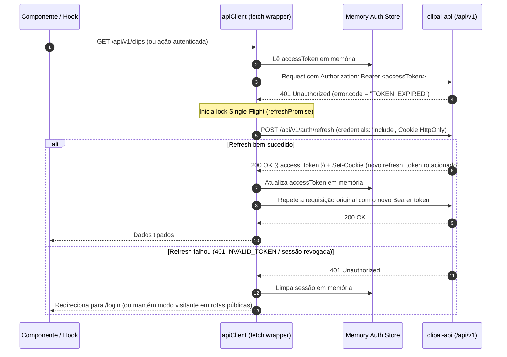
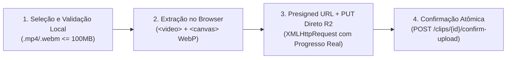

# Frontend Architecture Document — CLIPAÍ (`clipai-web`)

Este documento descreve a arquitetura técnica, organização de diretórios, protocolos de comunicação HTTP, pipeline de upload client-side para o Cloudflare R2, engenharia do player de vídeo e esteira de CI/CD com qualidade monitorada pelo **SonarCloud**.

---

## 1. Stack Tecnológica Oficial

| Camada | Tecnologia | Decisão Arquitetural |
| :--- | :--- | :--- |
| **Framework Core** | **Next.js (App Router)** + **React 19** | SSR/Metadata dinâmico para `/c/[slug]` (Open Graph no Discord/WhatsApp) e interatividade client-side rica no Dashboard Bento. |
| **Linguagem** | **TypeScript 5+ (`strict: true`)** | Tipagem estrita ponta a ponta (`noImplicitAny`, `strictNullChecks`, `noUncheckedIndexedAccess`), espelhando `docs/API_CONTRACT.md`. |
| **Estilização** | **Tailwind CSS** + **CSS Variables** | Tokens semânticos fechados (`--bg-deep`, `--bg-surface`, etc.) e geometria SVG customizada para o Hero Player em "L" e Sidebar Líquida. |
| **Ícones** | **Lucide React** | Biblioteca única de ícones vetoriais com traço consistente (`strokeWidth={1.75}`). |
| **Testes Automatizados** | **Vitest** + **React Testing Library** | Testes unitários e de integração rápidos para hooks, extração de mídia, cliente HTTP e componentes interativos. |
| **Qualidade e CI/CD** | **ESLint**, **Prettier**, **GitHub Actions**, **SonarCloud**, **Vercel** | Linting/formatação bloqueantes no PR, Quality Gate com cobertura `>= 80%` e deploy automático na Vercel. |

---

## 2. Árvore de Diretórios (`Next.js App Router`)

```text
clipai-web/
├── .github/
│   └── workflows/
│       └── ci.yml                          # Pipeline: Lint, Typecheck, Vitest (Coverage) e SonarCloud Scan
├── docs/
│   ├── API_CONTRACT.md                     # Contrato espelhado de clipai-api + interfaces TypeScript base
│   ├── DESIGN_SYSTEM.md                    # Tokens CSS, tipografia híbrida e geometria Bento
│   ├── FRONTEND_ARCHITECTURE.md            # Arquitetura técnica do cliente
│   └── PRD.md                              # Visão de UX, jornadas e escopo MVP vs. Pós-MVP
├── public/
│   └── fonts/                              # Fallbacks locais (se necessário; primário via next/font/google)
├── src/
│   ├── app/
│   │   ├── (auth)/                         # Grupo de rotas públicas de autenticação
│   │   │   ├── login/page.tsx
│   │   │   ├── register/page.tsx
│   │   │   ├── verify-email/page.tsx
│   │   │   ├── forgot-password/page.tsx
│   │   │   └── reset-password/page.tsx
│   │   ├── (dashboard)/                    # Workspace principal com Sidebar Líquida + Bento Grid
│   │   │   ├── layout.tsx
│   │   │   ├── page.tsx                    # Dashboard Bento (Hero Player "L", Filtros 3x3, Fila e Coleções)
│   │   │   ├── collections/
│   │   │   │   └── [collectionId]/page.tsx
│   │   │   ├── favorites/page.tsx
│   │   │   └── u/
│   │   │       └── [username]/page.tsx     # Perfil público / Meus clipes
│   │   ├── c/
│   │   │   └── [slug]/page.tsx             # Página dedicada de clipe compartilhável (SSR Open Graph + Player)
│   │   ├── globals.css                     # Declaração dos tokens CSS (:root) e utilitários líquidos
│   │   └── layout.tsx                      # RootLayout (Bebas Neue + JetBrains Mono, Providers, Toaster)
│   ├── components/
│   │   ├── bento/                          # Os 4 Componentes Signature do Dashboard Bento
│   │   │   ├── LiquidSidebar.tsx           # Sidebar Líquida Colapsável com fusão #061C2C e curvas côncavas
│   │   │   ├── LShapedHeroPlayer.tsx       # Hero Player em formato "L" com contorno SVG via ResizeObserver
│   │   │   ├── QuickFiltersGrid.tsx        # Card de Filtros Rápidos (Grid 3x3) encaixado no recorte do "L"
│   │   │   ├── QueueClipList.tsx           # Lista NA FILA / RECENTES em coluna limpa (gap: 10px)
│   │   │   └── CollectionFanWidget.tsx     # Widget COLEÇÕES em leque com animação bring-to-front
│   │   ├── upload/
│   │   │   ├── UploadClipModal.tsx         # Modal completo do fluxo de upload
│   │   │   ├── VideoDropzone.tsx           # Seleção/arraste de .mp4/.webm e validação instantânea
│   │   │   ├── ThumbnailFramePicker.tsx    # Seletor de frame e preview do <canvas>
│   │   │   └── UploadProgressBar.tsx       # Barra de progresso real (#2EB886) do PUT no R2
│   │   └── ui/                             # Componentes atômicos do Design System
│   │       ├── Button.tsx                  # Variantes CTA (Bebas Neue) e Secondary/Filter (JetBrains Mono)
│   │       ├── Input.tsx
│   │       ├── Badge.tsx
│   │       ├── Skeleton.tsx
│   │       └── Toast.tsx
│   ├── hooks/
│   │   ├── useLShapePath.ts                # Calcula o <path> SVG contínuo do Hero Player via ResizeObserver
│   │   ├── useClipUpload.ts                # Orquestra extração, Presigned URL, PUT com progresso e confirmação
│   │   ├── useVideoMetadata.ts             # Extrai duração, resolução, aspect ratio e frame WebP no cliente
│   │   ├── useAuth.ts                      # Acesso ao contexto de autenticação e sessão
│   │   └── useClipboardToast.ts            # Cópia de link compartilhável + disparo do toast #2EB886
│   ├── lib/
│   │   ├── api-client.ts                   # Cliente HTTP com credentials: 'include' e refresh single-flight
│   │   ├── media-inspector.ts              # Funções puras de inspeção de <video> e captura em <canvas>
│   │   ├── r2-uploader.ts                  # Upload binário via XMLHttpRequest com suporte a onProgress e abort
│   │   └── validators.ts                   # Validações client-side (limites de 100MB, 120s, MIME types, senha)
│   ├── services/
│   │   ├── auth.service.ts                 # Chamadas para /api/v1/auth/*
│   │   ├── clips.service.ts                # Chamadas para /api/v1/clips/*
│   │   ├── collections.service.ts          # Chamadas para /api/v1/collections/*
│   │   ├── users.service.ts                # Chamadas para /api/v1/users/*
│   │   └── catalog.service.ts              # Chamadas para /api/v1/games e /api/v1/tags
│   ├── stores/
│   │   ├── auth-store.ts                   # Estado do access_token em memória e dados do usuário logado
│   │   └── dashboard-store.ts              # Clipe ativo no Hero Player, filtros 3x3 ativos, fila e sidebar
│   └── types/
│       └── api.ts                          # Interfaces TypeScript espelhadas de docs/API_CONTRACT.md
├── tests/
│   ├── unit/                               # Testes unitários de hooks, media-inspector, validators e api-client
│   └── components/                         # Testes de componentes com React Testing Library
├── sonar-project.properties                # Configuração do SonarCloud
├── tailwind.config.ts
├── tsconfig.json
└── vitest.config.ts
```

---

## 3. Camada de Cliente HTTP e Ciclo de Autenticação (`src/lib/api-client.ts`)

### 3.1. Segurança de Tokens no Navegador (Mitigação XSS)
1. **Access Token Exclusivamente em Memória:** O `access_token` JWT (TTL de 15 minutos) retornado por `POST /api/v1/auth/login` ou `POST /api/v1/auth/refresh` é mantido **apenas em memória** (`auth-store.ts`). É terminantemente proibido persistir `access_token` ou `refresh_token` em `localStorage` ou `sessionStorage`.
2. **Refresh Token via Cookie `HttpOnly`:** O cookie `clipai_refresh_token` é gerenciado pelo backend (`HttpOnly; Secure; SameSite=Lax; Path=/api/v1/auth`). Para que o navegador envie e receba esse cookie em requisições cross-origin, o cliente HTTP usa **`credentials: 'include'`** por padrão.

### 3.2. Interceptação de `401` e Renovação *Single-Flight* (Mutex)



- **Prevenção de Race Conditions no Refresh:** Como o backend invalida o Refresh Token imediatamente ao rotacioná-lo (e revoga toda a `family_id` caso detecte reuso), o `apiClient` mantém uma variável singleton `refreshPromise: Promise<string | null> | null`. Se 3 requisições concorrentes receberem `401` ao mesmo tempo, apenas a primeira dispara `POST /api/v1/auth/refresh`; as demais aguardam a mesma `refreshPromise`.
- **Tratamento Padronizado de Erros (`ApiClientError`):** Qualquer resposta `4xx` ou `5xx` é desserializada no contrato `{ error: { code, message, details, request_id } }` e lançada como instância tipada de `ApiClientError`, garantindo que a UI exiba sempre `error.message` (já em PT-BR).

---

## 4. Fluxo Técnico do Upload Client-Side para Cloudflare R2

> [!CAUTION]
> O binário do vídeo e da thumbnail **jamais** devem ser enviados para rotas do Next.js (Route Handlers / Server Actions) nem para o FastAPI. O upload de mídia ocorre exclusivamente do navegador do usuário direto para o bucket **Cloudflare R2** via Presigned `PUT` URL.

### Pipeline em 4 Estágios (`useClipUpload.ts`)



#### Estágio 1 — Pré-validação Síncrona do `File`
- Verifica imediatamente `file.type` (`video/mp4` ou `video/webm`) e `file.size <= 104_857_600` (100 MB). Se falhar, aborta em `< 1ms` sem alocar objetos de mídia.

#### Estágio 2 — Extração de Metadados Técnicos e Captura de Thumbnail via `<canvas>` (`src/lib/media-inspector.ts`)
1. Cria uma Object URL temporária (`const objectUrl = URL.createObjectURL(videoFile)`).
2. Instancia um elemento `<video preload="metadata" muted playsInline>` desconectado do DOM.
3. No evento `onloadedmetadata`:
   - Lê `duration_seconds = Number(video.duration.toFixed(2))` e valida `1.0 <= duration_seconds <= 120.0`.
   - Lê `width = video.videoWidth` e `height = video.videoHeight`.
   - Calcula `resolution_label` (`2160p`, `1440p`, `1080p`, `720p`, `480p`), `aspect_ratio` (ex.: `16:9`) e `bitrate_kbps = Math.round((videoFile.size * 8) / duration_seconds / 1000)`.
4. **Captura Automática de Frame em WebP:**
   - Define `video.currentTime = Math.min(1.5, duration_seconds * 0.25)` (ou o segundo escolhido pelo usuário no seletor de frame).
   - No evento `onseeked`, cria um `<canvas>` proporcional (limitado a `1280×720` para manter a thumbnail leve e nítida), executa `ctx.drawImage(video, 0, 0, canvas.width, canvas.height)` e exporta via `canvas.toBlob(blob => ..., 'image/webp', 0.85)`.
   - Revoga a Object URL (`URL.revokeObjectURL(objectUrl)`) para evitar *memory leaks*.

#### Estágio 3 — Reserva de Presigned URLs e Upload Binário com Progresso (`src/lib/r2-uploader.ts`)
1. Envia `POST /api/v1/clips/upload-url` com os metadados extraídos, `video_size_bytes` e `thumbnail_size_bytes`.
2. Para o envio ao Cloudflare R2, utiliza **`XMLHttpRequest`** (pois a Fetch API nativa não expõe eventos de progresso de upload no browser):
   - Abre `xhr.open('PUT', presigned.url, true)`.
   - Define exatamente os headers assinados pela API (`Content-Type` correspondente ao `video_upload.headers` e `thumbnail_upload.headers`).
   - Escuta `xhr.upload.onprogress` para calcular `(loadedBytes / totalBytes) * 100` e atualizar a barra de progresso `#2EB886` a 60 FPS.
   - Expõe um `AbortController` / `xhr.abort()` caso o usuário cancele o envio no modal.

#### Estágio 4 — Confirmação no Backend
- Assim que os dois `PUT` (vídeo e thumbnail) retornam status `200 OK` do Cloudflare R2, o hook chama `POST /api/v1/clips/{clip_id}/confirm-upload`.
- O backend executa `HeadObject` no R2, muda o status do clipe para `'ready'` e devolve o objeto `ClipDetail` com as URLs públicas definitivas da CDN.

---

## 5. Estratégia do Player de Vídeo e Geometria SVG Dinâmica

### 5.1. Geometria do Hero Player em Formato "L" (`useLShapePath.ts`)
- O container principal do Hero Player possui dois elementos irmãos coordenados por um grid/wrapper relativo:
  1. A área de vídeo (`<LShapedHeroPlayer />`), recortada via `clip-path: path(...)` e sobreposta por um `<svg>` que desenha a borda contínua de `1.5px` em `#4F6478`.
  2. O card `<QuickFiltersGrid />` (Grid 3x3), posicionado no quadrante inferior direito onde o player sofre o recorte côncavo.
- Um único `ResizeObserver` monitora o wrapper do Hero Player e o card 3x3. Sempre que as dimensões mudam (ex.: ao colapsar/expandir a Sidebar Líquida ou redimensionar a janela), o hook recalcula em `requestAnimationFrame` a string `d` do `<path>` SVG com cantos arredondados suaves (`A 18 18 ...`) e o recorte semicircular esquerdo (`A 20 20 ...`) do botão da sidebar.

### 5.2. Engenharia de Reprodução e Telemetria de Views
- **Player HTML5 Customizado:** Utiliza `<video playsInline preload="metadata" poster={clip.thumbnail_url}>` com controles estilizados no Design System (barra de busca em `#2EB886`, indicador `REC` / badge de resolução `1080P 60FPS` em JetBrains Mono, controle de volume, velocidade `0.5x`–`2x` e Fullscreen).
- **Atalhos Táticos de Teclado (quando nenhum input está focado):**
  - `Space` ou `K`: Play / Pause
  - `F`: Alternar tela cheia (Fullscreen)
  - `M`: Mute / Unmute
  - `J` / `L` ou `ArrowLeft` / `ArrowRight`: Retroceder / Avançar 5 segundos
  - `,` / `.` (quando pausado): Avanço frame a frame (`1 / 60s`) para análise de jogadas
- **Contabilização de Visualização (`POST /api/v1/clips/{clip_id}/views`):**
  - Disparada uma única vez por sessão de reprodução do clipe após o usuário assistir a pelo menos **3 segundos reais** de vídeo (ou `25%` da duração em clipes muito curtos), evitando chamadas espúrias durante trocas rápidas na fila.

---

## 6. Gerenciamento de Estado

1. **Estado de Autenticação (`src/stores/auth-store.ts`):**
   - Mantém `accessToken: string | null`, `user: User | null` e `isInitializing: boolean`.
   - Na montagem inicial da aplicação (`AuthProvider`), executa uma tentativa silenciosa de `POST /api/v1/auth/refresh` seguida de `GET /api/v1/users/me` para restaurar a sessão a partir do cookie `HttpOnly` caso exista.
2. **Estado do Workspace Bento (`src/stores/dashboard-store.ts`):**
   - `isSidebarCollapsed: boolean` (sincronizado com `ResizeObserver` do Hero Player).
   - `activeClip: ClipDetail | ClipSummary | null` (clipe carregado no Hero Player em "L").
   - `activeFilter: { gameSlug?: string; tag?: string; sort: 'recent' | 'popular'; query?: string }` (sincronizado com o card de Filtros Rápidos 3x3 e com a URL via query params).
   - `activeCollectionOrder: string[]` (ordem dos IDs no leque interativo *bring-to-front* do widget de Coleções).
3. **Atualizações Otimistas (Curtir e Favoritar):**
   - Ao clicar em Curtir (`#D93848`) ou Favoritar (`#E8B04B`), a UI alterna imediatamente `is_liked_by_me` / `is_favorited_by_me` e incrementa/decrementa o contador local. Se a requisição `POST`/`DELETE` falhar, o estado é revertido e um toast de erro (`#8C2332`) é exibido.

---

## 7. Pipeline de Qualidade, CI/CD, SonarCloud e Vercel

### 7.1. Variáveis de Ambiente (`clipai-web`)
Apenas variáveis públicas não-sensíveis utilizam o prefixo `NEXT_PUBLIC_`:
- `NEXT_PUBLIC_API_BASE_URL`: URL base do backend (ex.: `http://localhost:8000/api/v1` em dev, `https://api.clipai.com.br/api/v1` em produção).
- `NEXT_PUBLIC_APP_URL`: URL canônica do frontend (ex.: `https://clipai.com.br`) usada para montar links compartilháveis (`/c/[slug]`) e metadados Open Graph.

### 7.2. Workflow do GitHub Actions (`.github/workflows/ci.yml`)
Executado em todo `push` e `pull_request` para `main` e `develop`:
1. **Install & Cache:** `npm ci` com Node.js 22 LTS.
2. **Static Analysis:**
   - `npm run lint` (ESLint com regras estritas de TypeScript e React Hooks).
   - `npm run format:check` (Prettier).
   - `npm run typecheck` (`tsc --noEmit`).
3. **Unit & Component Tests + Coverage:**
   - `npm run test:coverage` (Vitest gerando relatório `coverage/lcov.info` com gate mínimo de **80%** em `src/lib`, `src/hooks` e `src/services`).
4. **SonarCloud Scan (`SonarSource/sonarcloud-github-action`):**
   - Consome `coverage/lcov.info`, verifica **0 Bugs**, **0 Vulnerabilities**, **0 Security Hotspots não revisados**, **< 3% de duplicação** e **Complexidade Cognitiva < 15**.
5. **Deploy Contínuo (Vercel):**
   - Preview Deployments automáticos em cada Pull Request e Production Deployment ao aprovar o merge na `main` com Quality Gate verde.
